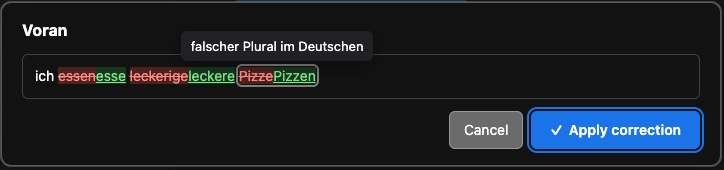

# Voran

**Fix your writing and learn while you do it, one right-click away.** ✨

Writing emails, chat messages or forum posts in a language you're still learning? Voran fixes your spelling and grammar and shows you why. You get better at the language just by writing in it, every day, wherever you already write. No flashcards, no separate app.

Select some text on any page, right-click, and pick **Fix text with Voran**. You'll see exactly what changed: mistakes are struck through and fixes are highlighted. Hover over a fix (or Tab to it) to read a short explanation, in your own language if you like. Over time you'll spot the same mistakes before Voran does.

Happy with the fix? Press **Apply correction** (or Enter) and it replaces your text. Changed your mind? Press Cancel and your text stays as it was. And if there was nothing to fix, you get a little green checkmark instead. Nice work! 🎉

Works in Chrome, Firefox and other Chromium browsers like Edge, Brave, Opera and Vivaldi, powered by Claude Haiku (or OpenAI's GPT-6 Luna, if that's more your style).



## Requirements

- Node.js 22 or newer
- Chrome 120 or newer (or another Chromium browser based on version 120 or newer), or desktop Firefox 140 or newer
- An API key from Anthropic or OpenAI

## Install

Build the extension:

```sh
npm install
npm run build
```

This creates one folder per browser: `dist/chrome/` and `dist/firefox/`.

**Chrome and other Chromium browsers**

1. Open the extensions page (`chrome://extensions` in Chrome, `edge://extensions` in Edge, `brave://extensions` in Brave) and turn on **Developer mode**.
2. Click **Load unpacked** and pick the `dist/chrome/` folder.

Voran is tested in Chrome. Edge, Brave, Opera and Vivaldi use the same extension system, so the `dist/chrome/` build should work there too.

**Firefox**

Run `npm run start:firefox`. This opens a fresh Firefox profile with Voran already loaded.

Or load it into your own Firefox: open `about:debugging#/runtime/this-firefox`, click **Load Temporary Add-on…** and pick `dist/firefox/manifest.json`. Firefox removes temporary add-ons when it restarts.

## Setup

Voran opens its options page right after you install it. There you:

1. **Pick a provider.** Anthropic is the default; OpenAI is the alternative.
2. **Paste your API key** for that provider.
3. **Grant access** if you see a **Grant access to api.anthropic.com** (or api.openai.com) button. Voran needs it to send your text for correction. If you remove this access later (Chrome: the extension's **Site access** setting; Firefox: `about:addons`), Voran asks for it again.
4. **Choose languages (optional).** Set the language of the text you correct (default: auto-detect) and the language of the explanations (default: English).

Changes save automatically.

## Usage

1. Select some text and right-click it.
2. Pick **Fix text with Voran**. A small "Checking…" label appears over the text while Voran works.
3. If there's something to fix, a dialog shows the changes. Press **Apply correction** (or Enter) to use them. Press **Cancel**, Esc or click outside the dialog to keep your text as it was.

If nothing needs fixing, you see a green checkmark over the text instead and nothing changes.

Where the fix ends up depends on where you selected the text:

| You selected text in…                     | What happens                                                                                                                                                                                                              |
| ----------------------------------------- | ------------------------------------------------------------------------------------------------------------------------------------------------------------------------------------------------------------------------- |
| `<input>`, `<textarea>`, contenteditable  | The text is replaced in place, and Ctrl/Cmd+Z still undoes it. In rich text (e.g. from Gmail or Docs) only the changed words are swapped, so bold, links and lists survive. A fix across a line break becomes plain text. |
| Read-only page text                       | The fixed text is copied to your clipboard.                                                                                                                                                                               |
| Text you edited while the dialog was open | The fixed text is copied to your clipboard, so your edits are not overwritten.                                                                                                                                            |

## How it works

```
right-click -> background (context menu) -> content script (captures selection, shows dialog)
content script -> background (voran:fix) -> api.anthropic.com or api.openai.com -> background -> content script
dialog applied -> content script replaces text
```

- `src/background.ts`: context menu, settings and API key lookup, correction call. The key never reaches page context.
- `src/content.ts`: captures the selection on `contextmenu`, drives the dialog, applies the replacement.
- `src/correction.ts`: provider-neutral prompt, tools, retry, timeout and segment alignment. The model must call one of two tools: `submit_correction` (ordered `segments`: unchanged `text` or `original`/`fixed`/`reason`, validated; `fixed` is derived) or `confirm_correct` (text already correct). No free text is parsed.
- `src/claude.ts`: Anthropic Messages API adapter (model `claude-haiku-5-5`).
- `src/openai.ts`: OpenAI Responses API adapter (model `gpt-6-luna`).
- `src/providers.ts`: provider names, hosts and key links.
- `src/diff.ts`: inline word-level diff via the `diff` package.
- `src/modal.ts`: dialog and toast in a shadow root. All text is inserted with `textContent`; `innerHTML` is banned by lint.
- `src/replace.ts`: selection capture and replacement for fields, contenteditable and read-only text.
- `src/languages.ts`: supported languages (English and native names), settings validation.
- `src/options.ts`, `src/options.html`: provider, API key and language settings (searchable language lists).
- `src/permissions.ts`: checks and requests host access to the selected provider's API (revocable in Firefox).

Privacy: your selected text goes only to the provider you chose (OpenAI requests use `store: false`, so OpenAI does not keep them). Each provider has its own stored key, and a key is sent only to its own provider's API. If you paste a key into the wrong provider's field (`sk-ant-…` keys are Anthropic's, other `sk-…` keys OpenAI's), Voran refuses to send it.

## Development

```sh
npm run watch
```

This rebuilds `dist/chrome/` and `dist/firefox/` whenever a source file changes. `manifest.json` and `options.html` are only copied when watch starts, so restart it after editing them.

After each rebuild, reload the extension (Chrome: the reload icon on `chrome://extensions`; Firefox: **Reload** on `about:debugging`, or nothing if you use `npm run start:firefox`), then reload the tab you're testing in.

There is only one `manifest.json`. `build.mjs` derives the Firefox version from it: the background script runs as an event page (`background.scripts`), `minimum_chrome_version` is dropped, and `browser_specific_settings.gecko` adds the add-on ID `voran@voran` and the minimum Firefox version.

Where to debug:

- **Background script:** Chrome: the **service worker** link on Voran's card on `chrome://extensions`. Firefox: **Inspect** next to Voran on `about:debugging`.
- **Content script and dialog:** the page's own DevTools. The dialog lives under `<voran-root>`.
- **Options page:** DevTools on the options tab.

### Checks

| Command                | What it runs                                                         |
| ---------------------- | -------------------------------------------------------------------- |
| `npm run typecheck`    | `tsc --noEmit` with all strict flags, for `src`/`tests` and configs  |
| `npm run lint`         | ESLint, `typescript-eslint` strict + stylistic type-checked, unicorn |
| `npm run format:check` | Prettier (`npm run format` to fix)                                   |
| `npm test`             | Vitest with happy-dom and coverage thresholds                        |
| `npm run check`        | All of the above                                                     |
| `npm run lint:firefox` | `web-ext lint` on `dist/firefox/` (build first)                      |

ESLint runs with `--max-warnings 0`. `innerHTML`, `outerHTML` and `insertAdjacentHTML` are errors.

`npm run lint:firefox` shows one warning you can ignore: `KEY_FIREFOX_ANDROID_UNSUPPORTED_BY_MIN_VERSION`. Firefox for Android only supports `data_collection_permissions` from version 142, but Voran doesn't run on Android anyway (it has no context menus). So the manifest has no `gecko_android` entry and keeps desktop Firefox ESR 140 as the minimum.

### Unit tests

`tests/` covers the diff, the Anthropic and OpenAI requests and their errors (with a mocked `fetch`), the cache, the dialog (including that page and model text is never parsed as HTML), selection capture and replacement, permissions, settings and the language picker. `background.ts`, `content.ts` and `options.ts` only wire these together; they're excluded from coverage and tested by hand with the checklist below.

### Manual test checklist

Make an HTML file with a `<textarea>`, an `<input>`, a `<div contenteditable>` and a `<p>`. Open it in both Chrome and Firefox and try text with mistakes, such as:

> Ich habe gestern ein Buch gelesen, das war sehr interessant gewesen. Die Kinder spielt im Garten.

- [ ] Menu item appears only when text is selected.
- [ ] Dialog shows an inline diff (struck-through removals, highlighted additions). Hovering or focusing a correction shows its reason in a tooltip; no bullet list.
- [ ] Textarea, input, contenteditable: text is replaced after **Apply correction** or Enter; **Cancel**, Esc and a click outside leave it unchanged. In contenteditable and textarea, Ctrl/Cmd+Z restores the original.
- [ ] `<p>`: corrected text is on the clipboard and a toast appears.
- [ ] Already-correct text: no dialog, green checkmark over the text, nothing changes.
- [ ] Wrong API key: error shown, nothing changes.
- [ ] OpenAI: select OpenAI in the options (the key field shows the OpenAI key, empty at first), enter an OpenAI key, correct text in a textarea and in contenteditable. A server error names OpenAI. Switching back to Anthropic shows the Anthropic key again and corrections go to Claude.
- [ ] Paste a key, then switch provider right away: the key is kept under the provider it was typed for.
- [ ] An Anthropic key in the OpenAI field (or the reverse): error, no request sent.
- [ ] No API key: error with an **Open options** button.
- [ ] Selection over 8000 characters: error, no request sent.
- [ ] Selection inside an iframe works.
- [ ] Options: typing "deu" or "日本" filters the language list; unknown text then leaving the field shows an error and saves nothing; changes save automatically and survive reloading the options page.
- [ ] Auto-detect: German, French and Japanese text are each corrected in their own language. With language = Spanish and explanations = Same as text, Spanish text is corrected with Spanish reasons.
- [ ] Detected language: with language = auto-detect, the dialog shows "Detected language: …" under the diff; with a fixed language, no such line appears.
- [ ] Arabic or Hebrew text renders right-to-left in the dialog.
- [ ] Fresh install: the options page opens by itself.
- [ ] API access: revoke "Access your data for api.anthropic.com" in `about:addons` > Voran > Permissions (Firefox). Voran shows an error with an **Open options** button; an already-open options page shows **Grant access to api.anthropic.com** without reloading. Dismissing the prompt shows "Access not granted."; granting hides the button and corrections work again. Cached text and text without letters still give their normal result while access is revoked.

## Project layout

```
manifest.json        extension manifest
build.mjs            esbuild bundling into dist/chrome and dist/firefox
src/                 extension source
tests/               unit tests
eval/                model quality eval (cases, runner, results)
icons/               extension icons
eslint.config.js     lint rules
tsconfig.json        strict config for src and tests
tsconfig.node.json   strict config for build and tool configs
```

## Limitations

- Your API key is stored unencrypted in `chrome.storage.local`.
- Firefox removes a temporary add-on when it restarts. Firefox for Android has no context menus, so Voran doesn't work there.
- You can check up to 8000 characters at a time.
- If you set a fixed text language, text that is clearly in another language comes back unchanged. Use auto-detect to avoid this.
- Auto-detect can guess wrong on very short or ambiguous text (a single word, closely related languages). The dialog shows which language it detected, so you can spot a wrong guess.
- About 45 languages are listed; more can be added in `src/languages.ts`.
- Text inside a page's own shadow DOM can't be replaced in place; the fixed text is copied instead.
- Read-only and disabled fields are never changed; the fixed text is copied instead.
- A correction gives up after 60 seconds. That includes one automatic retry if the model answers without using its tools.

## Contributing

Contributions are welcome! See [CONTRIBUTING.md](CONTRIBUTING.md). Contributing requires agreeing to the contributor license grant described there.

## License

[PolyForm Noncommercial License 1.0.0](LICENSE.md). Voran is free for personal, research, hobby and other noncommercial use, and for noncommercial organizations. For commercial use, contact the author about a separate license.
